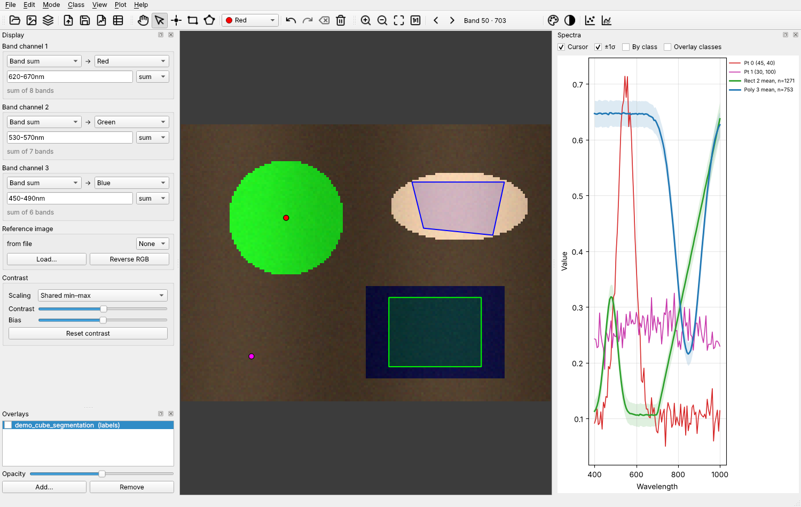
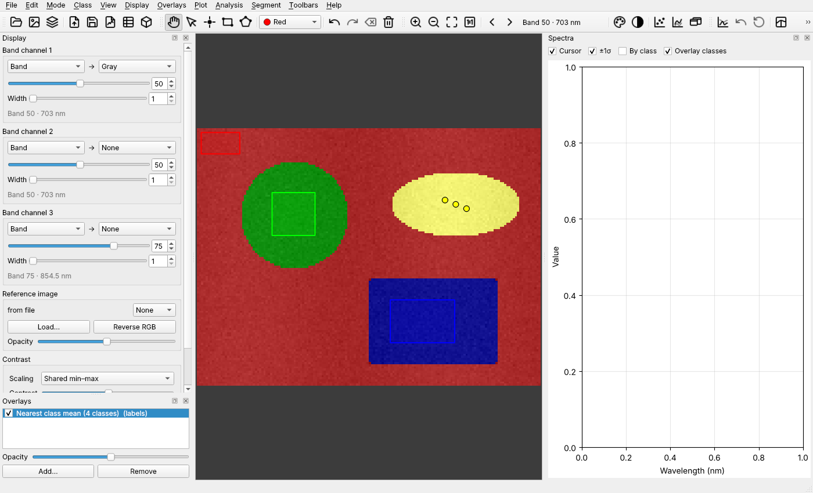
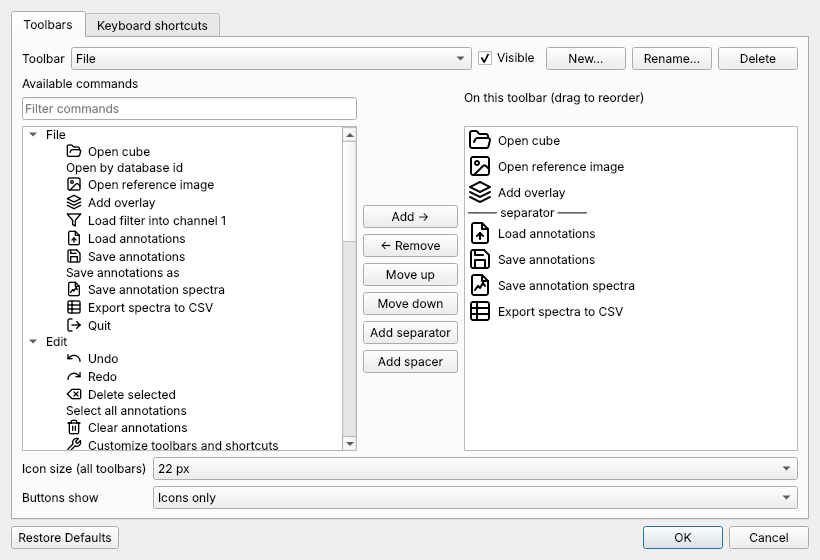

# hsview

View and annotate hyperspectral image cubes. A plain Qt (PyQt6) desktop app: images are drawn with Qt's raster painter, so no OpenGL is needed.



## Features

- **Display.** There are three band channels plus a reference image. Each channel's source is a single band (slider, with a *Width* slider that averages that many bands centred on it), a sum or mean of bands (`10-20, 35` or `650-700nm`), or a spectral filter loaded from a `.pkl`. Route each channel to red, green or blue, or show one alone as gray. The true colour preset builds RGB from wavelength ranges. The reference image (for example a pickle's `lbl`) can replace the display (*Show*) or be blended over it (*Overlay*) with its own opacity slider.
- **Contrast.** Contrast and bias work like the original viewer, plus a choice of shared min–max, per-channel min–max or 2–98 % stretch.
- **Navigation.** Zoom with the wheel (centred on the cursor) and pan by dragging in Navigate mode or with the middle button in any mode.
- **Annotations.** Points, rectangles and polygons in 7 classes (Red, Green, Blue, Yellow, Magenta, Turquoise, White). Right-click removes the annotation under the cursor. Select mode moves, recolours and deletes annotations. Undo and redo are supported.
- **Spectra.** The live panel shows annotation spectra (mean ±1σ for regions), the pixel under the cursor, means per class, and the class means of a segmentation overlay. The Plot menu draws one subplot per class, as the original viewer did, or, with *Plot → One window per class*, each class in its own window.
- **Overlays.** Integer images are shown as segmentations and anything else as a heat map, with visibility and opacity controls.
- **Files.** Annotations save to the original viewer's `.pkl` layout (or JSON). *Save annotation spectra* writes the original spectra pickle, and spectra can also be exported to CSV.
- **Analysis.** *Analysis → Remove background (SVD)…* subtracts the cube's mean spectrum, computes the SVD of the mean-removed cube (pixels × bands), and projects the *k* largest components out of every spectrum. The dialog shows how much variance each component carries and asks for *k*; an option adds the mean spectrum back (off by default, so the result is the residual around zero). The result replaces the displayed cube while annotations, overlays and display settings stay, so spectra, plots and exports use the processed cube. *Undo last analysis* and *Restore original cube* go back, and *File → Save cube as…* writes the processed cube as a `.pkl`, `.npz` or `.h5` with `ref`, `wavelengths`, `lbl` and the list of analyses applied (`processing`); see [docs/segmentation-format.md](docs/segmentation-format.md). New analyses are added in `hsview/analysis` (numerics) and `hsview/gui/analysis.py` (one `AnalysisCommand` each), and get a menu item, toolbar button and shortcut automatically.
- **Segmentation.** *Segment → Segment (unsupervised)…* splits the current cube, including any analysis already applied, into regions with k-means. *Segment → Segment from annotations…* trains on the pixels under the annotations (a point is one pixel, a rectangle or polygon every pixel inside) and classifies every pixel with nearest class mean, a linear discriminant (LDA) or k-nearest neighbours. Both can work on the first principal components, ignore brightness (unit-length spectra) and smooth the result with a majority filter. The result is shown as a label overlay (supervised results in the annotation class colours), and *Overlay classes* in the spectra panel plots each region's mean spectrum. *Segment → Save segmentation…* writes the labels, region names, colours, mean spectra, parameters, the cube's processing history and, for supervised runs, the training annotations to a `.pkl` or `.npz` that loads with plain `pickle`/`numpy`; see [docs/segmentation-format.md](docs/segmentation-format.md).



- **Everything is in the menus.** Every command, including the display panel's channel routing, band, band sum, filter, scaling, contrast and reference controls, the overlay list and the spectra panel's options, is also a menu item (*Display*, *Overlays*, *Plot*), so any of them can be put on a toolbar or given a shortcut.
- **Fully customizable toolbars.** The *Toolbars* menu edits every toolbar directly: show or hide it, tick commands to add or remove them, add separators and spacers, move or remove items (*Arrange items*), rename, delete or create toolbars, and choose the icon size and button style. You can also right-click any toolbar, or use *Edit → Customize toolbars and shortcuts…*, to:
  - add, remove and reorder commands, separators and spacers
  - create, rename and delete toolbars
  - choose the icon size and the button style
  - change any keyboard shortcut

  Toolbars can be dragged to any edge or floated. Everything is remembered between sessions.



- **Application icon.** Choose an icon under *View → Application icon* (default: the light scene cube with a pixel probe, also saved as `hsview-icon.png` in the repo root); the choice is remembered.

## Supported files

| Kind | Formats |
|---|---|
| Cubes | Pickled dict with `ref` (+ optional `wavelengths`, `lbl` reference image) or `hypercube` (+ `wavelengths`) |
| | Raw camera capture pickle with `frame` (16-bit Bayer bytes; loads as a 4-band red/green/green/blue cube, `webcam` becomes the reference) |
| | NumPy `.npz` with `ref` or `hypercube` (+ `wavelengths`, `lbl`), as *Save cube as…* writes |
| | MATLAB `.mat` (v7.3 via hdf5storage, older via scipy) with the same variable names |
| | ENVI (`.hdr` + data), `.npy` (wavelengths from `<name>_wavelengths.txt`), HDF5, TIFF |
| | Plain images (`.jpg`, `.png`, `.bmp`) as 3-band cubes |
| | A camera database id: `hsview 123` looks it up in `image_database.db` under `--image-dir`, `$HSVIEW_IMAGE_DIR` or `/Volumes/HyperspectralData/Images` |
| Reference images | jpg, png, bmp, tif (must match the cube size) |
| Filters | `.pkl` holding a `(bands,)` vector (dot product) or a `(bands, k)` matrix (fraction of energy in that subspace) |
| Overlays | `.npy`, `.npz`, `.tif`, `.png`, `.jpg`, `.h5`, `.pkl` (hsview segmentation files keep their colours) |
| Annotations | Original viewer `.pkl` (`points`, `rects`, `annotation_version`; polygons are added under `polygons`) or `.json`; the training annotations of a saved supervised segmentation |

Wavelengths that are missing, `None` or the wrong length fall back to the band index. DataLook scan collections must be converted with `DataLook.asHSI()` first. Pickles can run code when loaded, so only open files you trust.

## Install and run

```bash
python -m venv .venv && source .venv/bin/activate   # Windows: .venv\Scripts\activate
pip install -e .
hsview                         # empty window, then File → Open cube…
hsview data.pkl                # open a cube
hsview 123 --image-dir /path   # open by camera database id
hsview data.pkl --overlay seg.npy --annotations data_annotations.pkl
python -m hsview.demo demo.pkl # write a synthetic cube (and demo_segmentation.npy) to try
```

## Default keys

| Key | Action |
|---|---|
| N / S / P / R / G | Navigate, Select, Points, Rectangles, Polygons |
| 1–7 | Annotation class |
| [ / ] | Previous / next band |
| Ctrl+Z / Ctrl+Shift+Z | Undo / redo |
| Ctrl+0 / Ctrl+1 | Fit to window / actual pixels |
| Enter, double-click | Finish polygon (Esc cancels, Backspace or right-click removes the last vertex) |

All of these can be changed in the customize dialog.

## Adding a cube format

Write a function that returns `hsview.io.Cube(data, wavelengths, ...)` and register its extensions in `hsview.io.READERS`. Dict-style files can reuse `hsview.io.cube_from_dict`.

## Tests

```bash
pip install -e ".[test]"
pytest
```
