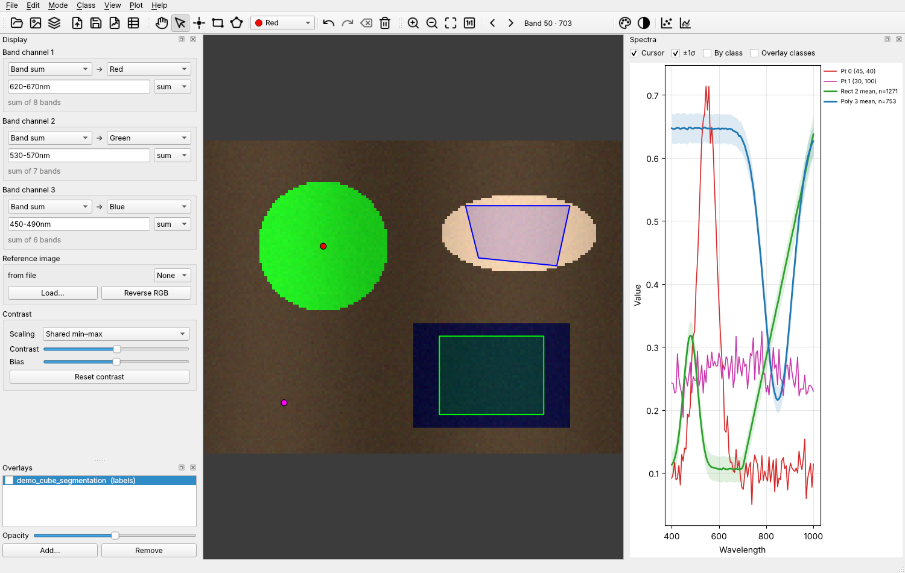
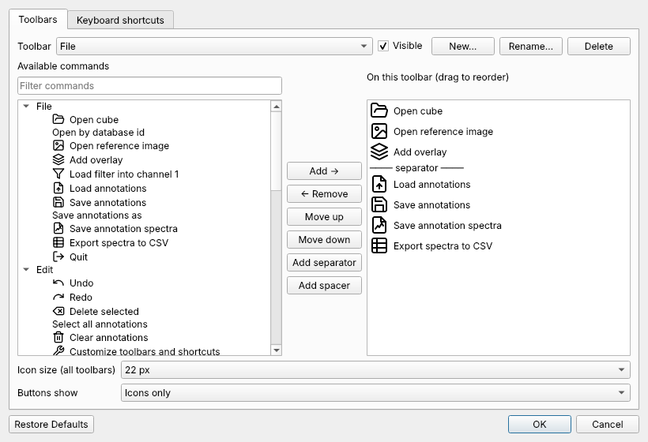

# hsview

View and annotate hyperspectral image cubes. A plain Qt (PyQt6) desktop app: images are drawn with Qt's raster painter, so no OpenGL is needed.



## Features

- **Display.** There are three band channels plus a reference image. Each channel's source is a single band (slider), a sum or mean of bands (`10-20, 35` or `650-700nm`), or a spectral filter loaded from a `.pkl`. Route each channel to red, green or blue, or show one alone as gray. The true colour preset builds RGB from wavelength ranges.
- **Contrast.** Contrast and bias work like the original viewer, plus a choice of shared min–max, per-channel min–max or 2–98 % stretch.
- **Navigation.** Zoom with the wheel (centred on the cursor) and pan by dragging in Navigate mode or with the middle button in any mode.
- **Annotations.** Points, rectangles and polygons in 7 classes (Red, Green, Blue, Yellow, Magenta, Turquoise, White). Right-click removes the annotation under the cursor. Select mode moves, recolours and deletes annotations. Undo and redo are supported.
- **Spectra.** The live panel shows annotation spectra (mean ±1σ for regions), the pixel under the cursor, means per class, and the class means of a segmentation overlay. The Plot menu draws one subplot per class, as the original viewer did.
- **Overlays.** Integer images are shown as segmentations and anything else as a heat map, with visibility and opacity controls.
- **Files.** Annotations save to the original viewer's `.pkl` layout (or JSON). *Save annotation spectra* writes the original spectra pickle, and spectra can also be exported to CSV.
- **Fully customizable toolbars.** Right-click any toolbar, or use *Edit → Customize toolbars and shortcuts…*, to:
  - add, remove and reorder commands, separators and spacers
  - create, rename and delete toolbars
  - choose the icon size and the button style
  - change any keyboard shortcut

  Toolbars can be dragged to any edge or floated. Everything is remembered between sessions.



## Supported files

| Kind | Formats |
|---|---|
| Cubes | Pickled dict with `ref` (+ optional `wavelengths`, `lbl` reference image) or `hypercube` (+ `wavelengths`) |
| | Raw camera capture pickle with `frame` (16-bit Bayer bytes; loads as a 4-band red/green/green/blue cube, `webcam` becomes the reference) |
| | MATLAB `.mat` (v7.3 via hdf5storage, older via scipy) with the same variable names |
| | ENVI (`.hdr` + data), `.npy` (wavelengths from `<name>_wavelengths.txt`), HDF5, TIFF |
| | Plain images (`.jpg`, `.png`, `.bmp`) as 3-band cubes |
| | A camera database id: `hsview 123` looks it up in `image_database.db` under `--image-dir`, `$HSVIEW_IMAGE_DIR` or `/Volumes/HyperspectralData/Images` |
| Reference images | jpg, png, bmp, tif (must match the cube size) |
| Filters | `.pkl` holding a `(bands,)` vector (dot product) or a `(bands, k)` matrix (fraction of energy in that subspace) |
| Overlays | `.npy`, `.tif`, `.png`, `.jpg`, `.h5`, `.pkl` |
| Annotations | Original viewer `.pkl` (`points`, `rects`, `annotation_version`; polygons are added under `polygons`) or `.json` |

Wavelengths that are missing, `None` or the wrong length fall back to the band index. DataLook scan collections must be converted with `DataLook.asHSI()` first. Pickles can run code when loaded, so only open files you trust.

## Install and run

```bash
python -m venv .venv && source .venv/bin/activate   # Windows: .venv\Scripts\activate
pip install -e .
hsview                         # empty window, then File → Open cube…
hsview data.pkl                # open a cube
hsview 123 --image-dir /path   # open by camera database id
hsview data.pkl --overlay seg.npy --annotations data_annotations.pkl
python -m hsview.demo demo.pkl # write a synthetic cube (and demo_segmentation.npy) to try
```

## Default keys

| Key | Action |
|---|---|
| N / S / P / R / G | Navigate, Select, Points, Rectangles, Polygons |
| 1–7 | Annotation class |
| [ / ] | Previous / next band |
| Ctrl+Z / Ctrl+Shift+Z | Undo / redo |
| Ctrl+0 / Ctrl+1 | Fit to window / actual pixels |
| Enter, double-click | Finish polygon (Esc cancels, Backspace or right-click removes the last vertex) |

All of these can be changed in the customize dialog.

## Adding a cube format

Write a function that returns `hsview.io.Cube(data, wavelengths, ...)` and register its extensions in `hsview.io.READERS`. Dict-style files can reuse `hsview.io.cube_from_dict`.

## Tests

```bash
pip install -e ".[test]"
pytest
```
